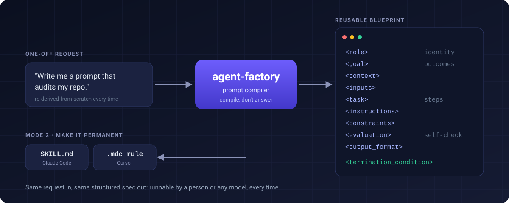

<div align="center">

# agent-factory

[](LICENSE)

### Stop writing prompts. Compile them.

**A prompt compiler for AI coding agents: it turns "write me a prompt for X" into a reusable, structured pseudocode blueprint, and on request into a permanent Claude Code skill or Cursor rule.**


**[Install](#install) · [How it works](#how-it-works) · [The schema](#the-schema) · [Example](#example) · [FAQ](#faq)**



</div>

---

Ask an agent for "a prompt that audits my repo" and you get one answer, shaped by whatever it improvised that day. Ask again next week and you get a different one. agent-factory changes the default move: instead of doing X, it produces the **specification that does X**, so a person or any model can run it and get the same quality of result every time, without re-deriving the approach.

It is a **compiler, not a generator**. The output is always a fenced block of angle-bracket tags, never prose, and never a conversational answer wearing a prompt's clothes.

## Install

### Claude Code

Global, available in every project:

```bash
git clone https://github.com/AlienWalker1995/agent-factory.git ~/.claude/skills/agent-factory
```

Or project-local: clone into `<your-repo>/.claude/skills/agent-factory/`. Claude Code discovers the skill from the frontmatter in [`SKILL.md`](SKILL.md) and uses it whenever you ask to "write a prompt for...", "build an agent that...", or "turn this into a reusable prompt". You can also invoke it as `/agent-factory`.

### Cursor

The repo ships a ready-to-use rule at [`.cursor/rules/agent-factory.mdc`](.cursor/rules/agent-factory.mdc).

- **Project-scoped:** copy `.cursor/rules/agent-factory.mdc` into your project's `.cursor/rules/`, with `SKILL.md` and `examples/` alongside so the relative links resolve.
- **Global:** copy it into `~/.cursor/rules/`.

It is an *Agent Requested* rule (`alwaysApply: false` plus a rich description), so Cursor pulls it in when your request matches, for example "compile this into a reusable prompt".

## How it works

| Mode | You say | You get |
|---|---|---|
| **1 · Compile** (default) | "Write me a prompt that audits my repo" | A fenced pseudocode blueprint you can paste into any model, any time |
| **2 · Make it permanent** | "Make this something I can invoke" | The same blueprint converted into a Claude Code `SKILL.md` or a Cursor `.mdc` rule |

Three rules shape every blueprint:

- **Compile, do not answer.** A request that reads like "help me produce X" gets the prompt that produces X. If it is genuinely unclear whether you want the artifact or the reusable prompt, it asks.
- **Every tag owns one job.** Tags that add nothing for this request are omitted rather than padded.
- **It must know when to stop.** Every blueprint ends in an explicit `<termination_condition>`, so the agent running it neither quits early nor loops.

## The schema

```
<role>                   expert identity + an explicit priority ordering
<goal>                   concrete deliverables, stated as outcomes, not activities
<context>                ground-truth situational facts
<inputs>                 the named artifacts, files, and data to work from
<task>                   numbered, decomposed steps
<instructions>           cross-cutting behavioral rules and rubrics
<constraints>            what NOT to do
<evaluation>             how to self-judge the draft before returning it
<output_format>          the exact return shape: sections, tables, schemas
<termination_condition>  the explicit stop condition
```

The full method, including how each tag is written and how Mode 2 conversion works, is in [`SKILL.md`](SKILL.md).

## Example

The canonical worked example is a repository auditor, [`examples/repository-auditor.txt`](examples/repository-auditor.txt). An excerpt:

```
<role>
  You are a Senior Software Engineer conducting a pragmatic repo audit.
  Your priority is: (1) pipeline works end-to-end, (2) follows common best practices for this project type,
  NOT: production-hardening, scaling, perf tuning, security compliance beyond “don’t do obviously unsafe things”.

<goal>
  Audit this Cursor repo’s CURRENT state and produce:
    A) a clear “does it run?” determination (and how to make it run),
    B) a pipeline map (components + data/control flow),
    C) a prioritized punch list to get the pipeline reliably working,
    D) best-practice alignment notes (lightweight, practical).
```

## FAQ

**Why pseudocode instead of a prose prompt?** Tags force decomposition. A model can skim a `<constraints>` block or check its draft against `<evaluation>`; it cannot reliably do that with three paragraphs of prose.

**Does it ever just answer the question?** Yes, when you ask for that. "Review my draft" or "just do X right now" is not a compile request, and it is treated as the normal task.

**Which models can run the blueprints?** Any. The output is plain text with no tool or vendor assumptions, so it works in Claude, ChatGPT, Gemini, or a local model.

**What is the difference between Mode 2 and just saving the blueprint?** A saved blueprint has to be pasted in. A `SKILL.md` or Cursor rule carries a description the agent matches against your requests, so it loads itself when it is relevant.

## Repo layout

```
SKILL.md                          the skill: full schema, workflow, and Mode 2
.cursor/rules/agent-factory.mdc   Cursor rule mirror of the skill
examples/repository-auditor.txt   canonical worked example (full schema)
references/bibliography.md        background reading
docs/assets/hero.svg              README banner
```

## Reference reading

Reforge's product-prompt guides, the pseudocode-prompting research, OpenAI's prompt-engineering docs, and Chip Huyen's *AI Engineering* are listed in [`references/bibliography.md`](references/bibliography.md).

## License

[MIT](LICENSE)
